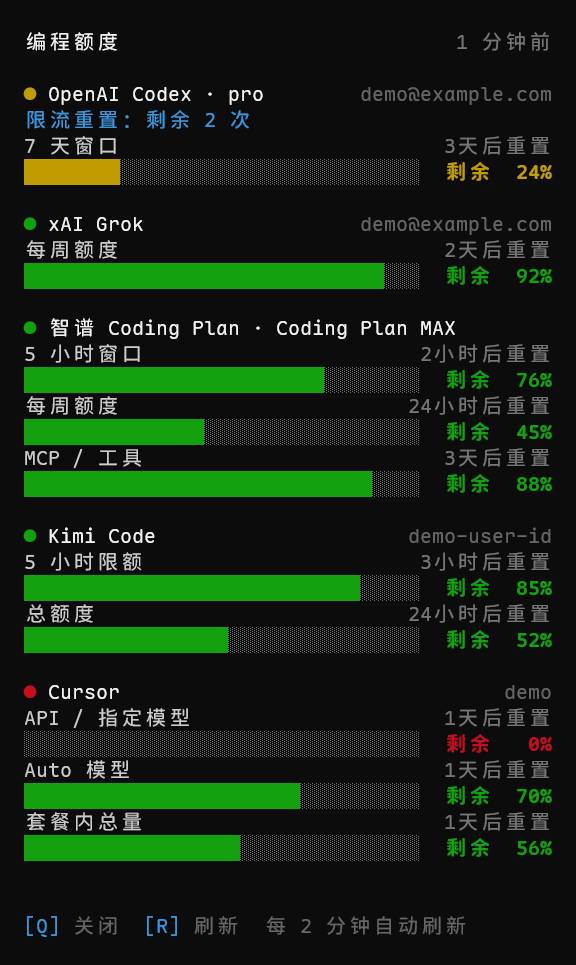

# coding-quota

See coding-plan quotas and API account balances in one place: **OpenAI Codex, Claude (Pro / Max), xAI Grok, Zhipu GLM Coding Plan, Kimi Code, Cursor, Devin, Google Antigravity, DeepSeek, and MiniMax**.



## Two flavors

| | `coding-quota-gui.exe` (desktop widget) | `coding-quota-tui.exe` (terminal TUI / CLI) |
| --- | --- | --- |
| UI | Borderless acrylic widget pinned to the desktop | Compact 48-column TUI in a frameless Windows Terminal window |
| Interaction | Drag the title bar to move the widget; drag provider cards to reorder; scroll overflowing cards; tray icon context menu | `R` refresh, `Q` quit, `↑↓` / `PgUp` / `PgDn` / `Home` / `End` scroll, auto-refresh every 2 minutes |
| Extras | Launch with Windows, per-provider visibility, window position memory | `--snapshot` plain text, `--json` for scripts, `-p <provider>` to filter, `--demo` for a mock-data preview |

## Download

Grab the executables from [Releases](../../releases):

- `coding-quota-tui.exe` — terminal TUI / CLI
- `coding-quota-gui.exe` — desktop widget

Both are standalone (only Windows system DLLs are linked), no installation required.

## Credentials

Zero configuration: most providers use the existing omp credential store (`~/.omp/agent/agent.db`) read-only and refresh tokens through omp. Antigravity instead queries the official `agy` CLI's signed-in account; no omp Google login or desktop Antigravity app is required. Providers without credentials are hidden automatically — nothing ever asks you to log in.

## Features

- Each quota window shows the remaining percentage, a usage-colored bar (green <70%, yellow ≥70%, red ≥90%), and its reset time
- Codex additionally shows remaining rate-limit reset cards and its credit balance (including Pro plans) directly under the corresponding window's progress bar (`重置卡：剩余 X 次` / `积分：剩余 X`), exactly matching Zhipu's style; finite balances retain decimals, unlimited credits are labelled explicitly, and unavailable balances are not shown as zero
- Zhipu shows available reset cards separately for the 5-hour and weekly windows; only records marked available are counted, and a reset-inventory query failure does not hide regular usage. Inventory queries are read-only: this tool never spends reset cards. The monthly MCP/tool quota shows remaining counts (`剩余 3925/4000`), not just a percentage
- Antigravity shows Gemini and shared Claude/GPT quotas, each with 5-hour and weekly windows, remaining percentages and reset times. These belong to Antigravity, not standalone Claude or Codex subscriptions. **Install the official Windows Antigravity CLI and sign in with `agy` once.** The tool directly runs `%LOCALAPPDATA%/agy/bin/agy.exe --print /usage --output-format json --disable-slash-commands=false` without a shell or console window. It reads the precise `command.data.groups[].buckets[]` values, not rounded display text. `/usage` is handled by the CLI itself, without an agent turn or model-token usage; slash handling is explicitly enabled even if disabled in your CLI settings. No desktop executable, Hub daemon, loopback API or extracted Google OAuth token is used. Authentication remains the CLI's responsibility. The short-lived CLI exits after each query; hidden providers are not queried, and normal failure caching/backoff remains. The quota result currently omits account email, so the card does not reuse the desktop app's identity. Use `--provider antigravity` or `--provider google-antigravity` to filter it.
- DeepSeek shows your official API account balance using the existing active omp `deepseek` API key and the read-only [`GET /user/balance`](https://api-docs.deepseek.com/api/get-user-balance) endpoint. The card displays `余额：¥29.24` (example) in white text, without a quota percentage or progress bar; CNY and USD balances stay separate. Use `--provider deepseek` with `--snapshot` or `--json`; JSON exposes `credit_balance` with `kind: money` and a `balance` array of `{amount, currency}`. Missing/invalid amounts are errors, not fabricated zero balances. Failed refreshes preserve last-good balances with their age; logout hides the card without reviving it from cache
- MiniMax shows official China Coding Plan quota using the existing active omp `minimax-code-cn` API key and the read-only [`GET /v1/token_plan/remains`](https://api.minimaxi.com/v1/token_plan/remains) endpoint. The card shows 5-hour and weekly remaining percentages with reset countdowns; GUI, TUI, snapshots, JSON, tray visibility and saved card order use the same report. Filter with `--provider minimax` or `--provider minimax-code-cn`. Explicit remaining percentages are authoritative even when API count fields are zero: no capacity or request count is fabricated. If MiniMax Code is logged in on this machine and its access token is still valid, the card also shows the same 积分 as the Code usage popover (`积分：剩余 X`, including a known zero) and weekly reset-card inventory (`重置卡：剩余 X 次 · 最早 MM-DD 到期`). Credits come from membership `op_credit_summary.total_remaining_amount`, not from `token_plan_credit.remaining_credits`. Those two reads use the local Code login, not the subscription key; if that login is missing or expired the quota bars stay and the extra lines are omitted. Plan quota comes from the server; the token-usage line still counts this machine's OMP session logs
- Token usage per card: retained local OMP session logs and native Claude Code logs are aggregated into Beijing-calendar-day / rolling 7 days / rolling 30 days / local-total rows, with model breakdowns in `--json`. Antigravity additionally reads `%USERPROFILE%/.gemini/antigravity-cli/conversations/*.db` read-only: each model generation contributes input + cache-read + output tokens, without adding thinking/text subsets again. Native model IDs and call/step timestamps determine the Gemini versus Claude/GPT group and day; conversation-wide model settings and file modification times are not used for attribution. Committed SQLite WAL data is included; the reader avoids databases younger than 3 seconds, and the 120-second scan cache watches both database and WAL changes. Existing OMP history is preserved and combined with CLI usage, never re-added on each refresh. "Local total" counts only retained records on this machine, not the account's lifetime total; deleted records and encrypted `.pb`-only stores are not part of the SQLite source. Zhipu also shows the official server-side 30-day total.
- Reset cards also show the earliest expiry date among available cards (`重置卡：剩余 5 次 · 最早 10-18 到期`, Beijing time MM-DD): Zhipu reads the inventory API's per-card `expireTime`, Codex reads the read-only `wham/rate-limit-reset-credits` detail endpoint (count still comes from usage; a detail failure only drops the date)
- Quota alerts fire native Windows tray notifications when a window's remaining percentage crosses a threshold: dropping to ≤10%, hitting zero, or resetting back to full. Alerts trigger only on real transitions observed at runtime (cache-seeded on startup, no replay); the tray menu has an on/off toggle and a "测试通知" entry to verify the channel
- `--json` exposes Codex `credit_balance` (`kind: limited` with `balance`, or `kind: unlimited`) and each Zhipu window's optional `resets_left`; missing fields mean unknown, while a known empty reset-card inventory is zero
- Failed refreshes keep the last good values (cached in `%APPDATA%\coding-quota\last_good.json`), drawn dimmed with their age; values older than 24 hours are dropped rather than shown, and a provider that keeps failing is retried with backoff instead of every round. `--json` / `--snapshot` always report the live result
- Both the widget and the TUI fit their size to the content
- GUI card order: hold the left mouse button on a provider card, drag it above or below another card — the target card lights up with a blue outline showing where the drop lands — then release. The list scrolls automatically while holding near its top/bottom edges. Order is saved in `%APPDATA%\coding-quota\card_order.txt` and survives refreshes and restarts; hiding a provider or logging out retains its position for when it returns. TUI/CLI order is unchanged

## Build from source

```
cargo build --release --features gui
```

The Windows target is `x86_64-pc-windows-gnu` (see `.cargo/config.toml` for the linker setup).

## License

MIT
